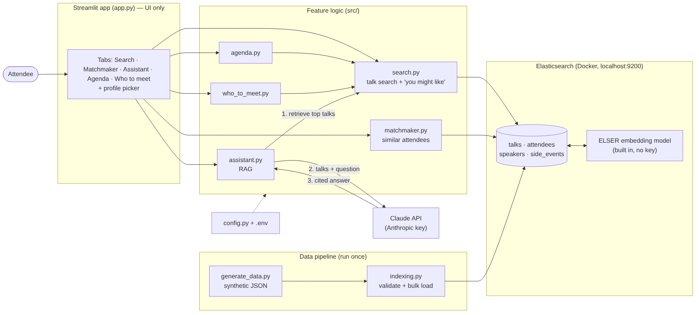
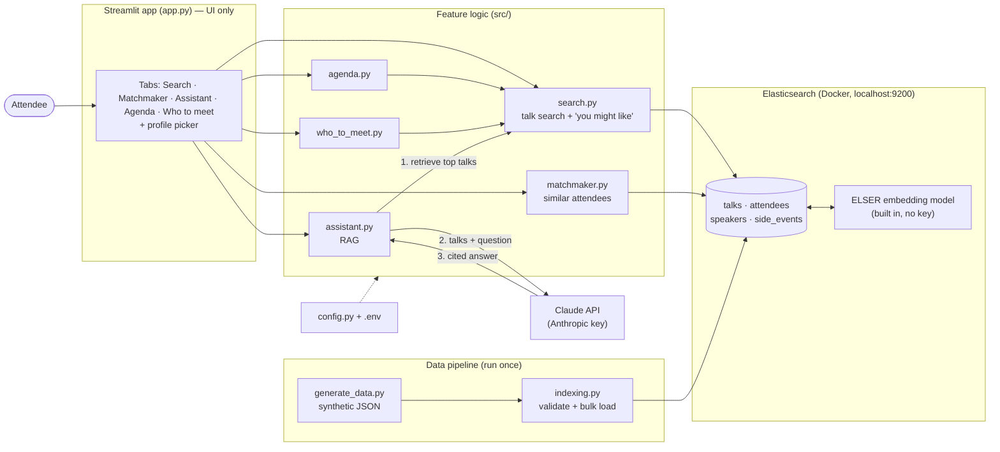

# Conference Search (Cloud Native Hackathon – Elasticsearch track)

> Project description goes here.

## Features
- [ ] Talk search by meaning
- [ ] Hallway matchmaker
- [ ] Conference assistant (RAG)

## Setup
1. Start Elasticsearch + Kibana locally (needs Docker):
   `curl -fsSL https://elastic.co/start-local | sh`
2. Create a virtual environment:
   ```bash
   python3 -m venv hackathon
   source hackathon/bin/activate
   pip install -r requirements.txt
   ```
3. Copy `.env.example` to `.env` and fill in your values.
4. Check everything connects: `python src/check_setup.py`

## Architecture



<details><summary>Mermaid source</summary>


</details>

**Layers**
| Layer | Files | Responsibility |
|---|---|---|
| UI | `app.py` | Streamlit tabs + profile picker. Displays results only — no queries or prompts. |
| Feature logic | `src/search.py`, `matchmaker.py`, `assistant.py`, `agenda.py`, `who_to_meet.py` | One module per feature. All talk retrieval goes through `search.py` (DRY). |
| Data access | `src/es_client.py`, `src/config.py` | One Elasticsearch client; all settings from `.env`. |
| Storage + vectors | Elasticsearch (Docker) | Indices: `talks`, `attendees`, `speakers`, `side_events`. `semantic_text` fields are embedded by the built-in ELSER model — no external embedding API. |
| Generation | Claude API | Used only by the assistant (RAG) to write answers from retrieved talks. |
| Data pipeline | `src/generate_data.py` → `src/indexing.py` | Generate synthetic JSON, validate, bulk-load. Run once; re-run to reset the demo. |

**Request flows**
- **Talk search:** query → `semantic` query on `talks.content` → ranked talks (+ "you might like" using the profile's `interests`).
- **Matchmaker:** profile's `working_on` → `semantic` query on `attendees.working_on` (excluding self) → closest people.
- **Assistant (RAG):** question → retrieve top talks via `search.py` → talks + question (+ profile) sent to Claude → answer citing talk titles.
- **Agenda / who to meet:** reuse `search.py` + filters (time slots, attendees) — no new retrieval logic.

## Data
_Describe data sources here._

## AI use disclosure
This project was built with help from Claude (Anthropic) as a coding assistant.
